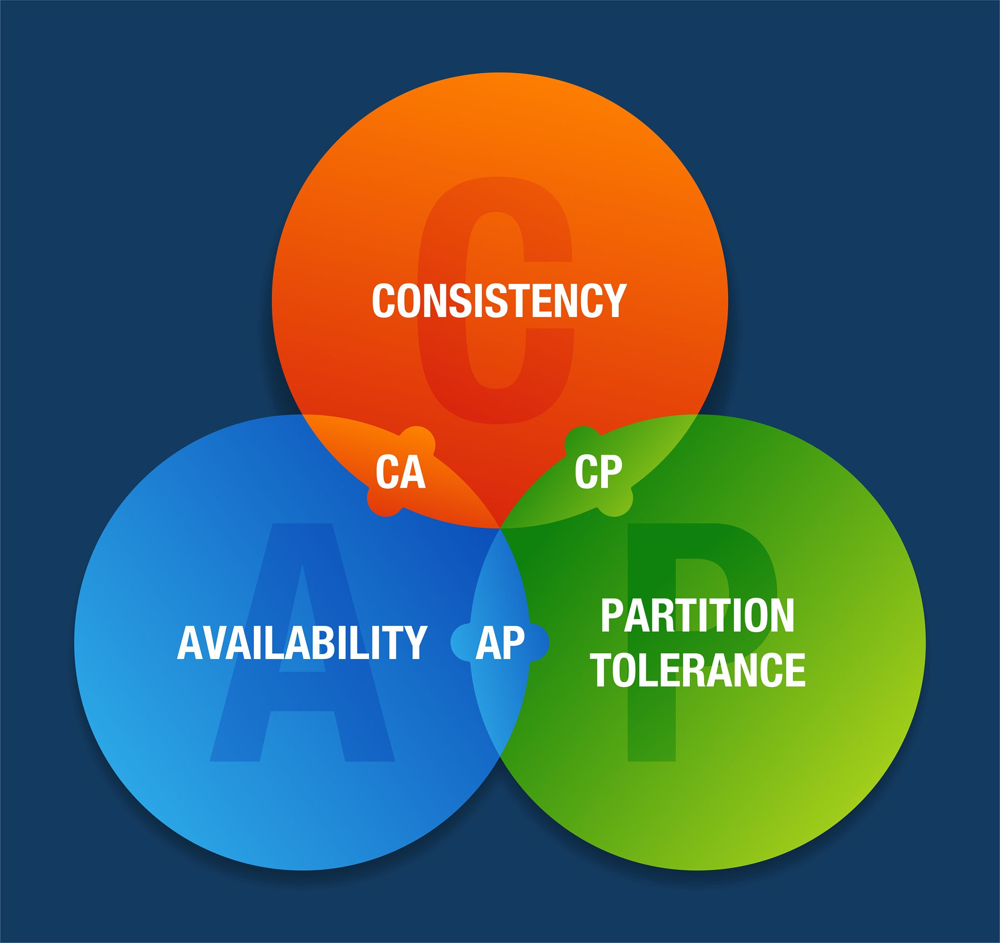

# CAP Theorem

## What is the CAP Theorem?
The CAP theorem is a rule for distributed data systems (data stored on more than one server).
It states that when the network connection between servers breaks, the system can guarantee only **two out of three** properties.

## The Three Properties
- **Consistency (C):** Every user sees the same, most recent data at the same time.
- **Availability (A):** Every request gets a response, even if the data is slightly outdated.
- **Partition Tolerance (P):** The system keeps working even when the connection between servers is lost.

## The Real Choice: C or A
Network failures (partitions) will always happen eventually, so a distributed system must support **P**.
That means the real choice, during a partition, is between **Consistency** and **Availability**.

## Example: Two ATMs
A bank has two ATMs (Node A and Node B) that share account data.

1. A storm cuts the network connection between the two ATMs (a partition).
2. You deposit $100 at ATM A.
3. One second later, your friend checks your balance at ATM B.

The bank system must now choose:

- **Consistency (CP):** ATM B shows an error and refuses to answer. The balance stays correct, but the ATM is effectively offline.
- **Availability (AP):** ATM B shows your old balance, without the $100. The ATM stays online, but the information is outdated.
